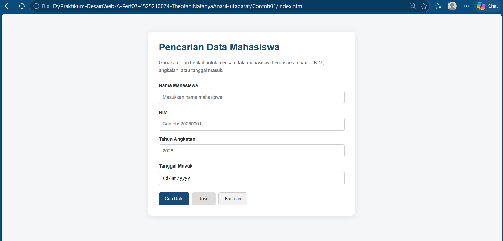
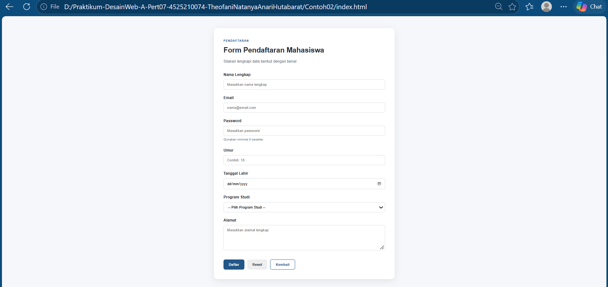

# IDENTITAS

- Nama: Theofani Natanya Anari Hutabarat
- NPM: 4525210074
- Mata Kuliah: Praktikum Desain Web - A
- Materi: Pertemuan 06
- Dosen: Ari Wibowo, S.Kom., M.Kom., C. Pro.

# DESKRIPSI PROYEK

Proyek Pertemuan 07 merupakan latihan pembuatan formulir menggunakan HTML dan CSS. Pada proyek ini terdapat dua contoh penerapan form, yaitu Form Pencarian Data Mahasiswa dan Form Pendaftaran Mahasiswa.

Kedua form dibuat untuk memahami penggunaan elemen HTML seperti `form`, `label`, `input`, `select`, `textarea`, dan `button`. Selain itu, proyek ini juga menerapkan atribut `method`, `action`, `name`, `type`, serta pengaturan tampilan menggunakan CSS agar formulir lebih rapi dan mudah digunakan.

# CONTOH 01 — FORM PENCARIAN DATA MAHASISWA

## Deskripsi

Contoh 01 merupakan halaman Form Pencarian Data Mahasiswa. Form ini digunakan sebagai contoh pengumpulan kata kunci pencarian berdasarkan beberapa data mahasiswa, yaitu nama, NIM, tahun angkatan, dan tanggal masuk.

Form menggunakan metode **GET** karena data yang dimasukkan ditujukan untuk kebutuhan pencarian. Ketika tombol Cari Data ditekan, data form dikirim melalui URL menuju halaman `hasil-pencarian.html`.

## Komponen Form

1. **Nama Mahasiswa** — menggunakan `input type="text"` untuk memasukkan nama.
2. **NIM** — menggunakan `input type="text"` untuk memasukkan nomor induk mahasiswa.
3. **Tahun Angkatan** — menggunakan `input type="number"` dengan batas nilai 2020 sampai 2030.
4. **Tanggal Masuk** — menggunakan `input type="date"` untuk memilih tanggal.
5. **Cari Data** — tombol `submit` untuk mengirim data pencarian.
6. **Reset** — tombol `reset` untuk mengosongkan kembali isian form.
7. **Bantuan** — tombol dengan `type="button"` sebagai tombol biasa.

## Penerapan CSS

Tampilan Form Pencarian Data Mahasiswa diatur menggunakan file CSS eksternal `Contoh01/CSS/style.css`.

Beberapa penerapan CSS yang digunakan:

- `box-sizing: border-box` untuk membantu pengaturan ukuran elemen.
- `.container` untuk mengatur lebar dan posisi form.
- `.form-card` untuk membuat area form dengan latar putih, padding, sudut melengkung, dan bayangan.
- `.form-group` untuk mengatur jarak setiap kelompok label dan input.
- `.button-group` menggunakan Flexbox untuk menyusun tombol.
- `:focus` untuk memberikan penanda ketika kolom input sedang dipilih.
- Media query `max-width: 600px` untuk menyesuaikan tampilan pada layar smartphone.

# CONTOH 02 — FORM PENDAFTARAN MAHASISWA

## Deskripsi

Contoh 02 merupakan halaman Form Pendaftaran Mahasiswa. Form ini digunakan sebagai contoh pengisian data pendaftaran yang mencakup informasi pribadi dan program studi.

Form menggunakan metode **POST**. Berbeda dengan GET, data POST dikirim melalui body HTTP request dan tidak ditampilkan sebagai parameter pada URL. Form diarahkan ke `/proses-pendaftaran` sebagai alamat tujuan pemrosesan data.

## Komponen Form

1. **Nama Lengkap** — menggunakan `input type="text"` dan wajib diisi.
2. **Email** — menggunakan `input type="email"` untuk memasukkan alamat email.
3. **Password** — menggunakan `input type="password"` agar karakter yang dimasukkan tidak ditampilkan secara langsung.
4. **Umur** — menggunakan `input type="number"` dengan batas nilai 16 sampai 80.
5. **Tanggal Lahir** — menggunakan `input type="date"` dan wajib diisi.
6. **Program Studi** — menggunakan elemen `select` dengan pilihan Teknik Informatika, Teknik Mesin, Teknik Elektro, dan Teknik Sipil.
7. **Alamat** — menggunakan `textarea` untuk memasukkan alamat lengkap.
8. **Daftar** — tombol `submit` untuk mengirim data pendaftaran.
9. **Reset** — tombol `reset` untuk mengosongkan isian form.
10. **Kembali** — tombol dengan `type="button"`.

Beberapa kolom menggunakan atribut `required` agar pengguna harus mengisi data sebelum form dapat dikirim. Atribut `min` dan `max` digunakan untuk memberikan batas nilai pada kolom umur.

## Penerapan CSS

Tampilan Form Pendaftaran Mahasiswa diatur menggunakan file CSS eksternal `Contoh02/style.css`.

Penerapan CSS pada halaman ini meliputi:

- Variabel CSS pada `:root` untuk menyimpan warna, warna teks, border, dan radius.
- `box-sizing: border-box` untuk mempermudah pengaturan ukuran elemen.
- `.registration-card` sebagai wadah utama formulir dengan padding, border radius, dan box shadow.
- `.form-header` untuk mengatur bagian judul dan deskripsi form.
- `.form-group` untuk memberi jarak antarkomponen formulir.
- Pengaturan tampilan `input`, `select`, dan `textarea` agar memiliki ukuran dan gaya yang konsisten.
- Efek `:focus` untuk menandai kolom yang sedang aktif.
- Gaya tombol melalui class `.btn`, `.btn-primary`, `.btn-reset`, dan `.btn-secondary`.
- Media query `max-width: 600px` untuk menyesuaikan ukuran kartu, judul, dan tombol pada layar smartphone.

# HASIL TAMPILAN

## Contoh 01 — Form Pencarian Data Mahasiswa

## Contoh 02 — Form Pendaftaran Mahasiswa

# KESIMPULAN

Melalui proyek Pertemuan 07, saya mempelajari cara membuat formulir menggunakan HTML dan mengatur tampilannya dengan CSS. Dua contoh yang dibuat menunjukkan penggunaan form untuk kebutuhan yang berbeda, yaitu pencarian data mahasiswa dengan metode GET dan pendaftaran mahasiswa dengan metode POST.

Saya juga mempelajari penggunaan berbagai jenis input, label, pilihan program studi, textarea, tombol, serta atribut seperti `name`, `required`, `min`, dan `max`. Penggunaan CSS eksternal dan media query membantu membuat tampilan formulir lebih teratur serta menyesuaikan ukuran layar. Dengan latihan ini, pemahaman mengenai pembuatan dan pengaturan form pada website menjadi lebih baik.
